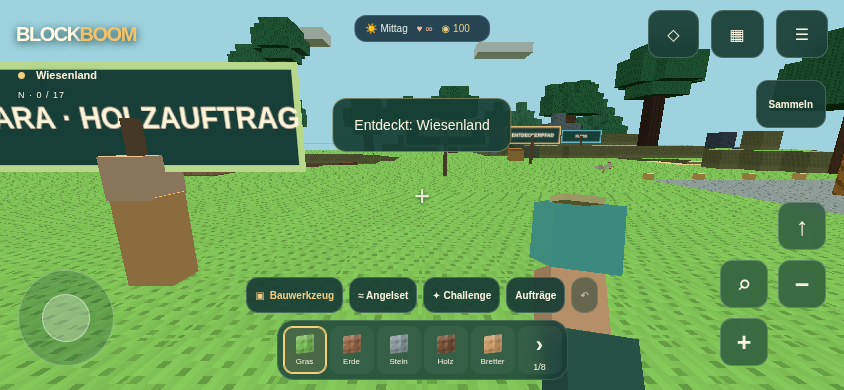
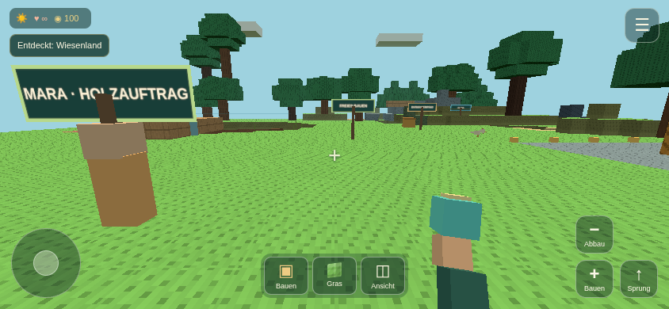
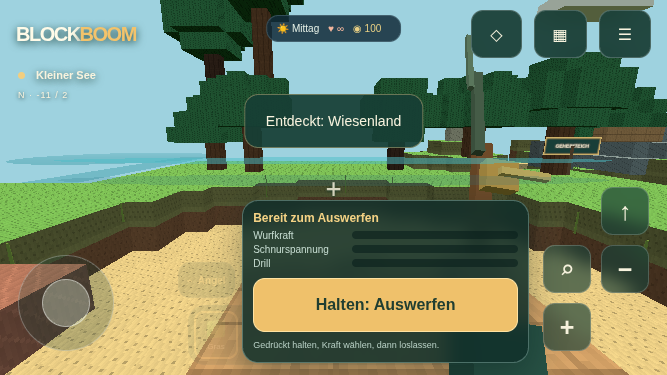
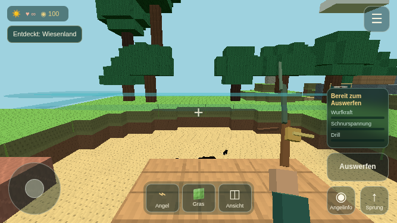

# BLOCKBOOM v0.6.1 – MOBILE UX RESCUE

## Ausgangsstand und belegte Ursachen

13. November 2026: sauberer `main`, identisch mit `origin/main`, auf `df8c664`. Bestehende v0.6-Produktionsversion `index-DE_B-dPy.js`. Baseline erneut ausgeführt: TypeScript strict, 75/75 Logiktests und Produktionsbuild bestanden. Entwicklung auf `feature/v061-mobile-ux`.

Die Rückmeldung vom echten iPhone stammt von der Auftraggeberin. Die folgenden eigenen Tests laufen in Chromium mit Software-WebGL und emulierten Mobilansichten; es wurde kein echtes iPhone angeschlossen.

### Bestätigt und korrigiert

1. **Zu viel dauerhaftes HUD.** Logo/Ortsangabe, drei obere Zugriffe, Werkzeug-/Challenge-/Auftragsreihe, sechs Materialfelder, mehrere Aktionsgruppen, Kontextbanner und Angelpanel waren gleichzeitig sichtbar. Die Vorheraufnahme bei 667×375 erfasst rund 38,3 % vereinigte HUD-Rechteckfläche, beim Angeln 44,2 %. Das bestätigt die sichtbare Überlagerung.
2. **Zoom verengte das Sichtfeld.** Der alte Schalter setzte `fov` auf `max(36, fov × 0,62)`. Direkt auf der veröffentlichten v0.6 reproduziert: 70° → 43,4°; nach Menü öffnen/schließen weiterhin 43,4°. Rendering lief dabei weiter. Es handelte sich in dieser Reproduktion um eine bleibende Nahansicht, keinen vollständigen Renderstillstand. Nachweis: `artifacts/v061/repro-zoom.json` und Vorherbild der Nahansicht.
3. **Kontakt konnte eingerastet bleiben.** Bei abgewiesenem Pointer Capture und anschließendem `pointerup` außerhalb der ursprünglichen Fläche hörte der alte Controller dieses Ende nicht. Der Vergleich mit Originalcode aus `df8c664` ergibt nach Loslassen weiterhin Bewegung `[0,1]`; ein neuer Finger bleibt wirkungslos. Der neue Controller setzt `[0,0]` und verarbeitet anschließend den neuen Finger unabhängig. Nachweis: `scripts/reproduce-touch.ts`, `artifacts/v061/repro-touch.json` und automatisierter Regressionstest. Dieser Ablauf ist reproduziert; ob genau dieser Ablauf auf dem gemeldeten iPhone auftrat, ist nicht nachgewiesen.
4. **Rückseiten der Schilder spiegelten Text.** Ein einzelnes doppelseitiges Text-Plane zeigt die Rückseite mit gespiegelter Schrift. Schilder besitzen jetzt zwei korrekt orientierte Vorderseiten mit gemeinsamem Material/Textur. Die Schilder wurden kleiner; Text wird in die verfügbare Texturbreite eingepasst.

### Nicht abschließend reproduziert

Ein vollständiges Hängen der gesamten iPhone-Darstellung wurde hier nicht reproduziert. Der ursprüngliche Renderloop plante seinen nächsten Frame bereits vor der Simulationsarbeit; ein grundsätzlich fehlender RAF-Neustart ist daher keine belegte Ursache. Ein konkreter Regionswechsel als Freeze-Auslöser ist ebenfalls nicht nachgewiesen. Es gibt keinen behaupteten endgültigen Safari-Freeze-Fix.

Die neue lokale Diagnose unterscheidet gewünschte Kameradistanz, tatsächliche Distanz, Kollision, Perspektive, Eingabebesitz, Viewport, native Browser-Vergrößerung, Renderfortschritt, Unterbrechungszustand und WebGL-Verlust. Höchstens 30 Ereignisse werden im Sitzungsspeicher gehalten. Export erfolgt nur durch einen bewussten Dateidownload; keine Telemetrie und kein Upload.

## Neue mobile Bedienung

- Im normalen Spiel: ein Menübutton, eine kleine Statusleiste, Joystick, drei Schnellzugriffsfelder und passende Aktionen am rechten unteren Rand.
- Schnellzugriff: aktives Werkzeug, Baumaterial und Ansicht/Abstand. Werkzeuge und Baustoffe öffnen sich bei Bedarf. Keine dauerhafte Challenge-/Auftrags-/Angelset-/Inventarreihe.
- Aktionsflächen 48×48 CSS-Pixel; Standardjoystick 88 Pixel, einstellbar zwischen 72 und 112. Visuelle Zurückhaltung über Hintergrunddeckkraft 20–75 %, bei weiter lesbaren Symbolen.
- Bauen/Abbauen, Angriff, Benutzen und Angelaktion werden anhand von Werkzeug, Ziel und Ort angeboten. Kein dauerhaftes „E – Abbauen“ auf Touch. Springen bleibt erreichbar.
- Menü führt zu Inventar, Werkzeugen, allen 39 Baustoffen, Welt/Karte, Challenges, alten Aufträgen, Angelset, Crafting/Survival, Steuerung und Einstellungen. Beeren, Schreibkampf, BOOM-Aufbau und Undo haben passende Menüwege.
- Lange Meldungen werden als kurze vollständige Rückmeldung gezeigt. Erfolgsfeedback wie „Auftrag geschafft“ bleibt sichtbar. Der volle letzte Hinweis ist im Menü lesbar. Hochformatempfehlung und Toast werden zeitlich getrennt angezeigt.
- Safe-Area-Variablen schützen Notch und Home-Anzeige. Im Hochformat liegen Joystick/Aktionen oberhalb der Schnellleiste; im Querformat an den äußeren unteren Rändern.
- Links-/Rechtshandoption vertauscht Joystick und Kamerafläche sowie die Aktionsgruppe. Schrift, Welt und Kamerarichtung werden nicht gespiegelt.
- Menüs nutzen die sichtbare Viewporthöhe und bleiben bei Bildschirmtastatur scrollbar. Die Ego-Hand ist auf Mobilgeräten kleiner, aber weiterhin sichtbar und animiert.

## Kamerasystem

- `CameraRig` trennt die Spielfigur von der Renderkamera. Ego erhält sichtbaren Arm und die vorhandenen Werkzeuge. Third Person zeigt eine eigene animierte Voxel-Spielfigur mit ausgerüstetem Werkzeug in einem InstancedMesh.
- Kameraentfernung im Menü stufenlos in 0,25-m-Schritten zwischen 2 und 9 m. Der Schnellzugriff wechselt von Ego zur gewählten Third-Person-Distanz, anschließend auf 6 m, 8 m und zurück zu Ego. Herauszoomen verändert tatsächlich die Position der Kamera.
- Sichtfeld bleibt davon unabhängig einstellbar zwischen 55° und 90°. Der alte verengende Zoomzustand entfällt.
- Kollisionsprüfung tastet den Weg vom Blickpunkt zur Kamera ab und berücksichtigt einen kleinen Kamerakörper. Mauern, Bäume, Boden und Weltgrenze verkürzen den Abstand sofort. Nach Freigabe wächst er weich zur weiterhin gespeicherten Wunschdistanz zurück.
- In sehr engen Räumen wird die Figur bei zu kurzer Sicht ausgeblendet; nötigenfalls erfolgt vorübergehend eine Ego-Sicht. Die gewünschte Third-Person-Distanz bleibt erhalten.
- Kamera-Reset steht direkt im Hauptmenü, auch bei unterbrochenem Rendering. Er löst Eingaben, stellt Ego/70°/Vorwärtsblick und 4 m für den nächsten Perspektivwechsel her. Normale Spielerposition, Welt und Inventar bleiben erhalten.
- Block-/Fischinteraktionen in Third Person werden vom Auge der Spielfigur zum anvisierten Punkt geprüft. Reichweite und Hindernisse bleiben maßgeblich; die weiter entfernte Kamera verlängert die Handreichweite nicht.
- Fehlende Loslassereignisse haben einen globalen Pointer-/Touch-Fallback. Zusätzliche Finger übernehmen keine fremden Kontakte. Reset/Hintergrund lösen auch aktive Buttonkontakte. Wegziehen und Zurückziehen ist kein Menütap.
- WebGL-Verlust unterbricht das Spiel getrennt von der manuellen Pause. Menü/Diagnose bleiben erreichbar. Nach Wiederherstellung kann bewusst fortgesetzt werden. Framefehler werden begrenzt protokolliert; ein gespeichertes Neuladen ist als weiterer Wiederherstellungsweg verfügbar.

## Speicherung und manueller Transfer

- Save-Key und Rootversion bleiben `blockboom.save` / 1. Neue additive Felder: `extension.camera` mit Version 1 und `extension.controls`. Alte FOV-/Empfindlichkeitswerte, Weltedition, Bauwerke, Tiere, Pflanzen, Fangbuch, Survival und Lernfortschritt bleiben gültig.
- Gewählte Distanz wird gespeichert; kollisionsbedingt verkürzte Distanz wird bei jedem Bild neu berechnet. Ein enger Ort schreibt keinen dauerhaft engen Kamerazustand in den Save.
- Menü → Einstellungen → Spielstand exportieren/importieren erstellt eine echte JSON-Datei mit Welt und getrenntem Lernprofil. Export verwendet den aktuellen Speicherzustand des Spiels und funktioniert auch ohne erfolgreiches localStorage-Schreiben.
- Import unterstützt diesen Sicherungsumschlag und bisherige einzelne Save-v1-Dateien. Erst Dateiprüfung und Vorschau, dann ausdrückliches Übernehmen per Button. Unbekannte Versionen, beschädigte Daten und Dateien über 8 MiB werden abgewiesen.
- Vor dem Ersetzen muss die Sicherung unter `blockboom.pre-import` geschrieben werden. Misslingt das, wird nichts importiert. Misslingt der zweite Bereich, werden Welt und Lernprofil zurückgesetzt. Ein abweichender Rollbackfehler wird ausdrücklich gemeldet.
- Die Sicherung vor dem letzten Import kann anschließend wieder als Datei heruntergeladen werden. Beim Import verhindert eine Seitenaustritts-Sperre, dass der alte In-Memory-Stand den gerade importierten Stand beim Reload überschreibt.
- Die bisherigen Grenzen bleiben bestehen: 50.000 Weltänderungen und die bekannten v0.6-Bestandsgrenzen. Keine IndexedDB-Umstellung und keine Cloud-Synchronisierung in diesem Qualitätsfix. Gleichzeitig aktive Tabs werden weiterhin nicht zusammengeführt.

## Architektur und Änderungen

| Datei | Änderung |
| --- | --- |
| `src/player/CameraRig.ts` | Abstand, Perspektive, Weltkollision, Rückkehr und Reparatur ungültiger Werte |
| `src/player/Avatar.ts` | gemeinsame Geometrie für Figur, Animation und sichtbares Weltwerkzeug |
| `src/player/TouchControls.ts` | globales Loslassen, Button-Reset, Drag-Schutz und Eigentümerdiagnose |
| `src/ui/MobileHUD.ts` | mobile Aktionsauswahl, drei Schnellfelder, kurze Meldungen |
| `src/ui/mobile-rescue.css` | ein konsistentes mobiles Layout, Safe Areas, Handbelegung und Menüs |
| `src/storage/Transfer.ts` | JSON-Transfer, Validierung, Sicherung und Rücksetzen |
| `src/inventory/Equipment.ts` | additive, validierte Kamera-/Steuerungseinstellungen |
| `src/main.ts` | verbindet Kamera, Zielprüfung, Menüs, Diagnose und Transfer mit dem vorhandenen Spiel |
| `src/tests/camera.test.ts`, `input.test.ts`, `transfer.test.ts` | Logik-/Integrationsregressionen |
| `e2e/mobile-ux.spec.ts`, `ui-helper.ts` | echte UI-Abläufe über die neuen Menüwege |
| `scripts/capture-mobile-ux.mjs`, `reproduce-touch.ts`, `reproduce-zoom.mjs` | Screenshot-/Mess- und Reproduktionsnachweise |

Vorhandene Browserfälle verwenden für verlegte Funktionen die tatsächlichen neuen Menüwege. Die FOV-Erwartung des alten Zoomtests wurde entsprechend der bewusst ersetzten Funktion geändert. Keine Tests wurden entfernt. Paket und Startbildschirm zeigen v0.6.1; es kamen keine Abhängigkeiten oder fremden Assets hinzu.

## Vorher-/Nachher-Nachweise

Messung bei identischen gespeicherten Positionen, FOV und Viewports. Gezählt wird die vereinigte Fläche sichtbarer HUD-Gruppenrechtecke, einschließlich transparenter Bereiche und ihrer Zwischenräume. 3D-Hand, Schilder und temporäre Toasts sind nicht Bestandteil dieser Kennzahl. Sie ist keine Pixelklassifizierung der tatsächlich verdeckten Welt.

| Viewport | Welt vorher | Welt v0.6.1 | Angeln vorher | Angeln v0.6.1 |
| --- | ---: | ---: | ---: | ---: |
| 667×375 | 38,3 % | 13,5 % | 44,2 % | 17,7 % |
| 844×390 | 34,7 % | 10,2 % | 39,3 % | 13,4 % |
| 932×430 | 30,7 % | 8,4 % | 34,5 % | 11,0 % |

Aufnahmen des abschließenden Builds `index-D554htlW.js` / `index-DUrYSO9D.css`, identische Positionen wie v0.6.0. Der versetzte Joystickknopf wurde bei der Bildkontrolle erkannt, über das zentrierende Flexlayout korrigiert und durch eine geometrische Browserprüfung abgesichert.

| Situation | Vorher v0.6.0 | Nachher v0.6.1 |
| --- | --- | --- |
| Welt, 844×390 |  |  |
| Angel, 667×375 |  |  |

[Sichtbare Third-Person-Figur](artifacts/v061/after/third-person.png), [alte Nahansicht](artifacts/v061/before/844-narrow-view.png), [Vorher-Messdaten](artifacts/v061/before/coverage.json), [Nachher-Messdaten](artifacts/v061/after/coverage.json), [Touch-Reproduktion](artifacts/v061/repro-touch.json), [Zoom-Reproduktion](artifacts/v061/repro-zoom.json).

## Tatsächlich ausgeführte Tests und offene Schlussprüfung

- Baseline: strict TypeScript, 75/75 Logiktests, Build.
- Erster neuer Kamerakern: 84/84 Logiktests und **10/10 neue Browserfälle** bestanden. Darunter echte Mehrfingerereignisse, Baumkollision mit Weglaufen/Rückkehr, gespeicherte Perspektive, Bauen/Abbauen in Third Person und ein vollständiger Third-Person-Angelfang bis ins Inventar.
- Export/Import und kontrollierter WebGL-Verlust: **2/2 zusätzliche Browserfälle** bestanden. Import prüft tatsächliche Dateiinhalte, Sicherung, Weltänderungen und Fischzahlen nach Reload. WebGL-Test prüft Wiederherstellung der Renderframes.
- Erweiterter Logikkern: **90/90 Tests** in zwölf Dateien und TypeScript bestanden. Zusätzliche Prüfungen umfassen alte Einstellungen, Kamerakollision/Distanzrückkehr, ungültige Werte, Kontaktende außerhalb der Fläche, verlorenen Buttonkontakt, richtige Aktionsauswahl sowie Import-Rollback bei Speicherfehlern.
- Ein Zwischenlauf zeigte eine echte Rückmeldungslücke: ein langer Fangtext wurde vollständig durch „Neuer Hinweis“ ersetzt. Der kompakte Text erhält jetzt den Auftragserfolg; ein neuer Test sichert das ab.
- Erster Gesamtbrowserlauf bewusst beendet: 61 bestanden, fünf fehlgeschlagen, ein Fall unterbrochen und acht nicht ausgeführt. Neben der korrigierten Rückmeldungslücke erwarteten alte Tests noch alte Überschriften, Buttontexte und Menüwege. Ein Schreibkampftest pausierte Gegner unmittelbar beim Spawn außerhalb der echten Interaktionsreichweite; der Test wartet jetzt auf einen tatsächlich nahen Gegner. Diese Prüfungen wurden auf echte neue Bedienwege angepasst, ohne Spielprüfungen zu entfernen.
- Gezielter Nachlauf: zehn Fälle bestanden, eine zunächst unpassende Browser-Zoom-Erwartung fehlgeschlagen. Chromium beachtete korrekt die bestehende Zoombegrenzung. Der korrigierte einzelne Test bestand: normale Seitenvergrößerung bleibt blockiert; ein ausdrücklich nur im Test geänderter Viewport simuliert eine Browser-/Bedienungshilfen-Ausnahme. Native Skalierung wird erfasst, während Kameraabstand und FOV unverändert bleiben. Das ist kein echter Safari-Pinch-Test.
- Ein erneuter Gesamtlauf wurde nach vier bestandenen Fällen für die bei der Screenshotprüfung entdeckte Joystick-Zentrierung gestoppt; ein Fall unterbrochen, 71 nicht ausgeführt. Danach erneut strict TypeScript, **90/90 Logiktests** und Produktionsbuild bestanden.
- Vollständiger Browserlauf auf dem endgültigen Spielbuild: **75 bestanden, ein zusätzlicher Browser-Skalierungstest fehlgeschlagen**, Dauer 14,1 Minuten. Alle Spiel-, Kamera-, Multitouch-, Speicher-, Legacy- und Pages-Fälle bestanden. Der Zusatztest änderte die Viewport-Metadaten erst nach dem Start und setzte die Skalierung, bevor Chromium die neue Begrenzung zuverlässig übernahm. Die Testfixture liefert die geänderte HTML-Metadatenzeile nun vor dem Parsen aus; der ausgelieferte Spielcode und dessen Zoombegrenzung bleiben unverändert.
- Korrigierter Skalierungstest: **5/5 Wiederholungen bestanden**, 50,4 Sekunden. Damit sind alle 76 unterschiedlichen Browserszenarien erfolgreich geprüft, jedoch nicht als ein einzelner vollständig grüner 76er-Lauf. [Gesamtlaufprotokoll](artifacts/v061/local-regression.log) und [Nachtestprotokoll](artifacts/v061/viewport-repeats.log) halten diese Unterscheidung fest.
- Ein vorheriger Wiederholungsversuch hatte fünf Verbindungsfehler `ERR_CONNECTION_REFUSED` bereits beim Seitenaufruf: der lokale Vorschauserver war nach der Sitzungspause beendet. Nach geprüftem Neustart erfolgte der oben dokumentierte erfolgreiche Nachtest. Diese Verbindungsfehler sind keine bestandenen Spielprüfungen.

Reproduzierbarer lokaler Prüfweg:

```sh
npm ci
npm run typecheck
npm test
npm run build
npm run preview -- --port 4206
# In einem zweiten Terminal:
BLOCKBOOM_TEST_URL=http://127.0.0.1:4206/Blockboom-/ npm run test:browser
node scripts/capture-mobile-ux.mjs after
./node_modules/.bin/vite-node scripts/reproduce-touch.ts
```

Chromium unter `/usr/bin/chromium` wird wie bisher verwendet. Die Vorherbilder wurden vor Veröffentlichung von v0.6.1 erstellt. `reproduce-zoom.mjs` erwartet ausdrücklich die alte veröffentlichte v0.6.0 und verweigert die Reproduktion auf einer anderen Version, damit kein aktueller Stand fälschlich als Vorhernachweis ausgegeben wird.

## Performance und Grenzen

- Eine zusätzliche Figur als ein InstancedMesh, höchstens 24 Boxteile. Vorhandene Werkzeuggeometrien werden wiederverwendet. Kameraabstand ist auf 9 m und ihre Kollisionsschritte sind begrenzt. Keine neue Physikengine, Schattenkette oder Nachbearbeitung.
- HUD ersetzt große gleichzeitige Bediengruppen; transparente Flächen brauchen keinen mobilen Blurfilter. Menüs/Paletten werden nur bei Bedarf gezeigt.
- Third-Person-Zielprüfung benötigt eine zusätzliche Sichtlinie. Die bestehende begrenzte Welt-/Tier-/Gegnerverwaltung bleibt erhalten.
- Messpunkte der sechs Nachheraufnahmen: 45–76 Draw Calls, rund 18.600–24.500 Dreiecke, jeweils 55 Geometrien und zehn Texturen. Dies sind Momentaufnahmen unterschiedlicher Blickrichtungen im Software-Browser; daraus folgt keine gemessene Smartphone-Framerate und kein Vorher-/Nachher-GPU-Geschwindigkeitsgewinn.
- Bestehender Streaming-/Geometriestest nach den letzten Änderungen: acht Regionswechsel, höchstens 38 Weltmeshes und 59.675 geladene Blöcke, 163 alte Geometrien freigegeben und 27 aktive am Ende. Alle Mengen-/Freigabe-Assertions bestanden. Die hier gemessene maximale synchrone Rebuild-Zeit von 179,66 ms zeigt weiterhin ein mögliches Ruckelrisiko beim Regionswechsel; kein belegter dauerhafter Kamera-Freeze.
- Reale iPhone-/Android-FPS, Energieverbrauch, Wärme und ein längerer Gerätetest sind offen. Software-WebGL ersetzt diese Messungen nicht.
- Native Safari-Seitenvergrößerung und Betriebssystem-Bedienungshilfen sind von der Spielkamera getrennt. Viewport-Skalierung wird diagnostiziert. Ein entsprechender Auslöser des ursprünglichen iPhone-Problems ist nicht belegt.
- Kamerakollision verwendet konservative Blockkörper, keine exakten Möbeloberflächen. In sehr engen Räumen ist vorübergehend eine nähere/Ego-Sicht sinnvoll. Die Third-Person-Werkzeugmodelle sind einfacher als die erhaltenen Ego-Modelle.

## Konkrete iPhone-/Android-Abnahme

1. Vorhandenen Spielbrowser verwenden, nur einen aktiven Spieltab offen lassen. Seite neu laden, **v0.6.1** prüfen, Querformat wählen. Website-Daten nicht löschen. Optional zuerst Menü → Einstellungen → Spielstand exportieren.
2. Normales HUD ansehen: Welt bleibt frei; links Joystick, rechts wenige Aktionen, unten drei Schnellfelder, oben Status und Menü. Notch/Home-Anzeige dürfen nichts verdecken.
3. Gleichzeitig gehen und schauen; erst einen, dann den anderen Daumen lösen. Dritten Finger kurz aufsetzen. Kein automatisches Pausenmenü und keine weiterlaufende Bewegung nach Loslassen.
4. „Ansicht“ antippen: eigene Figur sichtbar; weiterer Tipp vergrößert den Abstand. Im Menü Kameraabstand zwischen 2 und 9 m verändern. Sichtfeld darf beim Herauszoomen nicht enger werden.
5. Hinter einen Baum und an eine Hauswand gehen, nach oben/unten schauen und wieder ins Freie laufen. Die Kamera soll ausweichen und zur Wunschdistanz zurückkehren. In enger Lage Menü → Kamera zurücksetzen ausprobieren; anschließend wieder beide Daumen benutzen.
6. Werkzeuge/Material über die Schnellfelder wechseln. Bauen, abbauen und Undo testen. Inventar über das Menü öffnen/schließen; Angel wählen, werfen, anschlagen und drillen. Zombie mit Waffe bekämpfen und über das Menü freiwillige Wortmagie öffnen.
7. Browser kurz verlassen und zurückkehren; bewusst weitergehen. Hoch-/Querformat wechseln. Bei Texteingabe müssen Eingabefeld, Abschlussbutton und Schließen erreichbar bleiben.
8. Empfindlichkeit, Joystickgröße, Deckkraft und Handbelegung ändern; speichern und neu laden. Bauwerke, Fische, Tiere, Pflanzen und Lernfortschritt prüfen.
9. Exportdatei in „Dateien“/Downloads sichern. Import nur mit bewusst ausgewählter Sicherung und passender Vorschau testen; vorherige Sicherung anschließend wieder herunterladen können.
10. Falls die extreme Nahansicht erneut auftritt: nicht zuerst Website-Daten löschen. Menü → Einstellungen → Kameradiagnose speichern, Ansicht/Fingerfolge sowie Gerät, iOS-/Android- und Browserversion notieren. Kamera-Reset und gegebenenfalls gespeichertes Neuladen ausprobieren. Falls die gesamte Website nativ vergrößert ist, den Browser-Seitenzoom auf 100 % prüfen.

## Commits und Deployment

- `f3eb6a4`: kompakter mobiler HUD, echte Third-Person-Kamera, sichere Touchkontakte, neue Regressionen.
- `e15d247`: Diagnose und Wiederherstellung härten, abgesicherten Spielstandtransfer und weitere Regressionen ergänzen.
- `662a25a`: Joystick zentrieren, Zentrierung prüfen und Perspektive verständlich für Vorlesefunktionen beschriften.
- Dokumentations-/Nachweiscommits, endgültige Ergebnisse und tatsächlicher Veröffentlichungsstatus werden nach Prüfung ergänzt.
- Zieladresse: **https://selinajordan87-stack.github.io/Blockboom-/**. Noch keine v0.6.1-Veröffentlichung bestätigt.

Geprüftes Produktionsbundle: `index-D554htlW.js`, SHA-256 `653f18e8758487ea74c3d6a3f485f12c8e658b3aeade6ef2e9b973e412882587`. CSS `index-DUrYSO9D.css`, SHA-256 `57cdff84432d510edcecbea7166198d6422589703ead8002c70a07c4a6886247`. Node 24.22.1. Der bestehende offizielle Pages-Workflow und der Basispfad `/Blockboom-/` bleiben unverändert.
